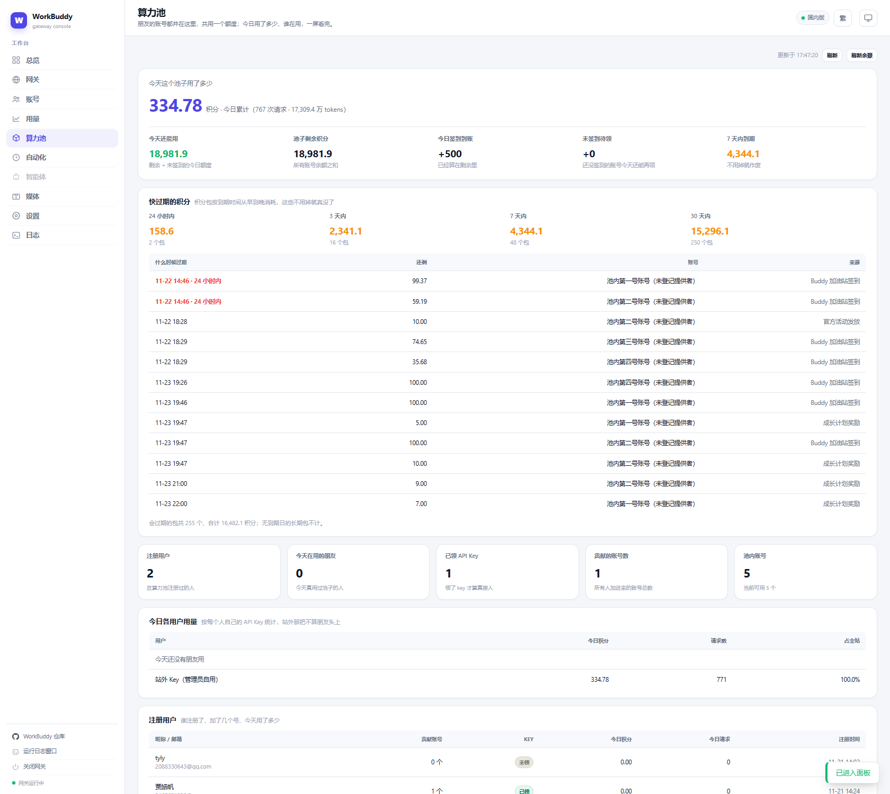
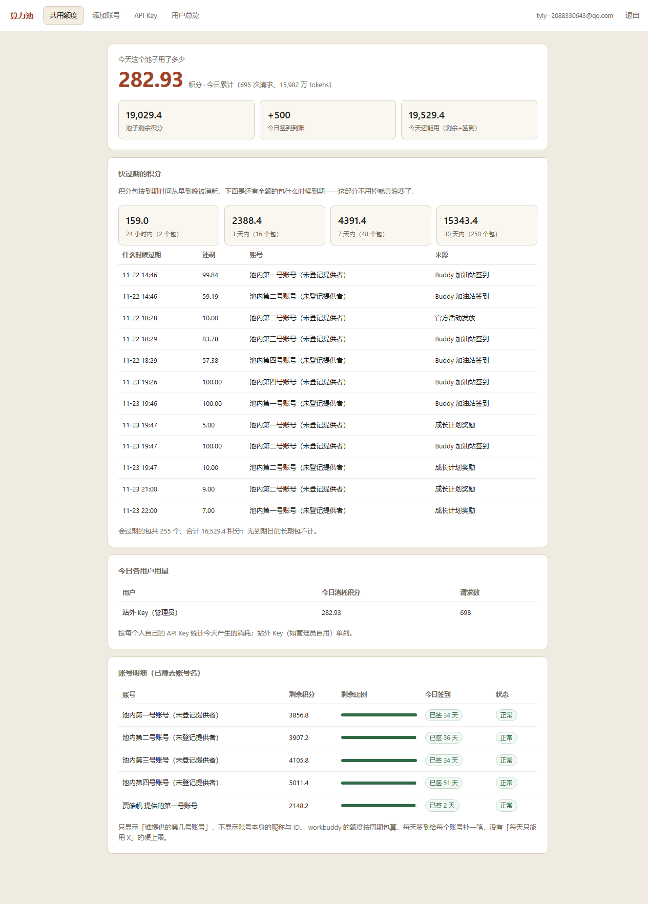

# WorkBuddy2API-Hub · 我们的部署版

> 这是 [**niyouqianma/workbuddy2api-hub**](https://github.com/niyouqianma/workbuddy2api-hub) 的 fork（MIT）。
> 上游代码一行没改：我们所有改动都放在 **`ours/`** 里，作为外挂层部署。
> 上游完整文档（安装、环境变量、API 端点、逆向致谢）原样保留在 **[docs/UPSTREAM-README.md](docs/UPSTREAM-README.md)**。

<p align="center">
  
  
  
  
</p>

## 这个 fork 用来做什么

上游把 WorkBuddy 账号变成 OpenAI 兼容 API，自带一个单页管理面板。
我们在此基础上加了**朋友之间的共享池**：一个独立小站（注册 / 看共用额度 / 加号 / 领 Key），
并在原生面板里加一页「算力池」，把池子的账一屏看完。

关键取舍：**不往镜像里塞代码**。面板镜像由 watchtower 每天检查更新，改镜像里的文件一次自动升级就白改；
所以小站挂在 nginx 的 `/join/`，面板里的那一页由 nginx 在 HTML 末尾注入一个脚本。



## 我们加了什么

| 位置 | 内容 |
|---|---|
| `ours/portal/portal.py` | 朋友自助小站：注册登录、共用额度、加号（官方 OAuth）、领 API Key、管理员用户总览 |
| `ours/portal/panel-ext.js` | 注入主面板的「算力池」页；复用面板的 `X-Panel-Token` 鉴权，不另设密码 |
| `ours/deploy/join-panel.service` | systemd 单元（`python3 /opt/join-panel/portal.py`，只监听 `127.0.0.1:8790`） |
| `ours/deploy/nginx-ours.conf` | nginx 片段：`/join/` 反代 + `/wb/` 注入 `panel-ext.js` |
| `ours/deploy/install.sh` | 幂等部署脚本，带备份、自检、`--rollback` |
| `ours/docs/CHANGES-OURS.md` | 改动清单与理由（含性能数据、那个 302 白屏 bug） |

### 1. 朋友自助小站 `/join/`

- **`/`** 昵称 + 邮箱 + 密码注册登录（无验证码）
- **`/dashboard`** 共用额度：今日已用、池子剩余、签到到账、今天还能用；
  **快过期的积分**按 24 小时 / 3 天 / 7 天 / 30 天分档，并列出最近到期的积分包
- **`/accounts`** 加号：走官方 OAuth（`/accounts/login/start` + `poll`），密码不经过本站；带步骤说明与四条 FAQ
- **`/keys`** 领 Key：没贡献过账号不给领；写明 Base URL、`Authorization: Bearer`、模型名、报错对照表
- **`/admin`** 仅管理员邮箱：注册用户、今日活跃、已领 Key、贡献账号数、今日全站消耗、每人用量

账号一律匿名成「谁谁提供的第几号账号」，不暴露 workbuddy 那边的昵称。
页面上的 Base URL 跟请求的 `Host` 走，不写死域名；反代改了 Host 时用环境变量 `PUBLIC_BASE` 覆盖。



### 2. 面板里多一页「算力池」

由 nginx 在 `/wb/` 的 HTML 末尾注入 `panel-ext.js`：

- 侧栏与手机底部导航各加一项，与面板原生页签互不串页
- 鉴权复用面板令牌：前端读 `sessionStorage` / `localStorage` 里的 `wb-proxy-panel-token`，
  后端拿它回问 `/panel/status` 的 `authenticated`，通过才给数据
- 「刷新余额」：后台逐号去上游重取（2 路并发、错峰 200ms），页面显示 `刷新中 2/5`，不阻塞

### 3. 三个性能坑（都是实测出来的）

| 现象 | 数据 | 处理 |
|---|---|---|
| 打开页面等十秒 | `/accounts/credits` 现拉 5 个号 **10.35s**；`/accounts` 读内存快照 **7ms**、同样 182KB | 展示一律读 `/accounts` |
| 人一多就排队 | `/usage/recent` 两页 1.2MB、每页 40ms，N 个人同时开就解析 N 遍（GIL） | 换 `/usage/analytics`（7ms、200KB）+ 5 秒共享缓存 |
| 偶发卡一下 | 默认 listen backlog 只有 5，几十个并发连接被拒后重试 | `request_queue_size=256` |

压测结果（同一台 2 核 / 1.6G 服务器，本机回环）：

```
             改前      改后
 1 人        0.105s    0.105s
10 人同时    1.15s     0.080s
30 人同时    2.5s      0.18s  (p95 0.30s)
60 人同时    6.3s      0.36s  (p95 0.57s)
```

模型侧并发另测：5 个账号下 1 / 3 / 6 / 12 路小请求全部 200，p50 约 1.5s，12 路最慢 2.25s。

### 4. 修掉的一个真 bug

`/join/` 对已登录用户返回 302 时，把 `"Location: /join/dashboard"` 当成了 `Content-Type` 参数传，
响应里根本没有 Location 头 → 浏览器白屏。已修，并在 `_send()` 里加了自检：
3xx 没 Location、或 Location 被误传成别的头，都会写一条 `BUG` 到 `/var/log/join-panel.log`。

## 快速安装

前置：已经跑着上游网关（`/wb/` 能打开）、系统里有 `nginx` 与 `python3`。

```bash
git clone -b ours git@github.com:Tieria-coder/workbuddy2api-hub.git
cd workbuddy2api-hub
sudo bash ours/deploy/install.sh
```

脚本做四件事，每步先备份：

1. `portal/` 装到 `/opt/join-panel/`（已有文件备份成 `*.bak-<时间>`）
2. 装 systemd 单元并启动 `join-panel.service`
3. 给 nginx 打两处补丁（`/join/` 反代、`/wb/` 注入脚本），`nginx -t` 通过才 reload
4. 自检：`/join/` 200、`/join/panel-ext.js` 200、`/join/admin/api/overview` 无令牌 401、`/wb/` 200 且已注入

跑完：朋友用 `http://<host>/join/`，你自己用 `http://<host>/wb/`（左侧多一页「算力池」）。

> `/opt/join-panel/panel-pass` 是主面板密码的副本，portal 用它读账号余额。
> 首次安装会生成一个占位文件，记得改成真实面板密码。

## 回滚

```bash
sudo bash ours/deploy/install.sh --rollback
```

恢复 nginx 与 `/opt/join-panel/` 的最近备份，停用并禁用 `join-panel.service`。
只想去掉面板里那一页：删掉 `/wb/` 里那三行 `sub_filter` 即可，其它不受影响。

## 分支与同步上游

- **`main`** — 与上游一致，只用来合并
- **`ours`** — 我们自己的层（默认分支）

```bash
git remote add upstream https://github.com/niyouqianma/workbuddy2api-hub.git
git fetch upstream
git checkout main && git merge --ff-only upstream/main && git push origin main
git checkout ours && git merge main          # 我们的改动都在 ours/ 里，冲突面很小
```

## 已知限制

- **没在一台全新机器上从零装过**：`install.sh` 只在已有环境上验了幂等与回滚。
- nginx 补丁按 `location /wb/ {` 这段定位，面板反代写法变了需要人工确认。
- 上游镜像更新后如果改了侧栏 DOM（`#nextNav`、`.main-page` 这些），注入脚本要跟着调；
  改的是 `panel-ext.js`，不用重建镜像。
- 面板与 `/join/` 目前都是明文 HTTP；有域名后套 Cloudflare Tunnel 再加 HTTPS。
- 上游 README 里「非官方客户端可能被收紧」的风险提示同样适用于本 fork，不再重复。

## 许可与致谢

上游 MIT，本 fork 同样 MIT，原版权声明保留在 [LICENSE](LICENSE)。
网关、面板、逆向与协议细节全部来自上游作者与社区，见
[docs/UPSTREAM-README.md](docs/UPSTREAM-README.md) 的「致谢与引用声明」。
`ours/` 里这部分是我们自己写的。
